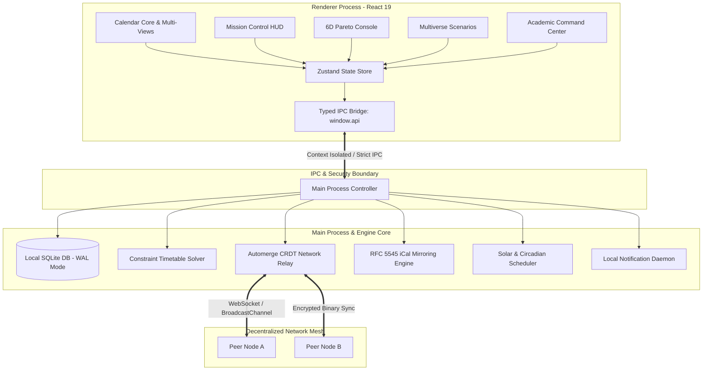

<div align="center">

# Stoa

**Architectural Scheduling Engine & Local-First Spatial Workspace**

[](https://www.typescriptlang.org/)
[](https://react.dev/)
[](https://www.electronjs.org/)
[](https://tailwindcss.com/)
[](https://automerge.org/)
[](LICENSE)

_Stoa is a high-performance, local-first calendar operating system engineered for knowledge workers, researchers, academic institutions, and distributed engineering teams. Inspired by classical architectural principles, it unifies constraint-based scheduling, six-dimensional trade-off optimization, temporal agent swarms, and decentralized peer-to-peer synchronization._

[Features](#key-capabilities) • [Architecture](#system-architecture) • [Getting Started](#getting-started) • [Engines](#core-computational-engines) • [Keyboard Shortcuts](#keyboard-shortcuts) • [License](#license)

---

</div>

## Overview

Modern calendar applications treat time as a passive grid of empty boxes. **Stoa** models time as an active, multidimensional resource governed by energy dynamics, cognitive load constraints, and collaborative realities.

Built with **React 19**, **Electron**, **Tailwind CSS v4**, and **Automerge CRDTs**, Stoa combines offline-first database guarantees with zero-latency local operations, cryptographically verified peer-to-peer synchronization, and predictive scheduling intelligences.

```
       ┌────────────────────────────────────────────────────────┐
       │                      STOA RUNTIME                      │
       └────────────────────────────────────────────────────────┘
                 │                                    │
    ┌────────────────────────┐           ┌────────────────────────┐
    │     Main Process       │           │    Renderer Process    │
    │  (Node / SQLite / IPC) │           │ (React 19 / Vite / UI) │
    └────────────────────────┘           └────────────────────────┘
                 │                                    │
    ┌────────────────────────┐           ┌────────────────────────┐
    │  • Native SQLite (WAL) │           │  • Dynamic OKLCH Theme │
    │  • Automerge CRDT Repo │           │  • Zustand Micro-Stores│
    │  • RFC 5545 iCal Sync  │ ◄───────► │  • 6D Radar & Sankey   │
    │  • Background Timers   │  Typed    │  • Live Meeting HUD    │
    │  • Native Notifications│   IPC     │  • Multiverse Trees    │
    └────────────────────────┘           └────────────────────────┘
```

---

## Key Capabilities

### 1. High-Precision Calendar Suite

- **Week, Day, Month, & Agenda Views**: Sub-millisecond rendering with virtualized time-grids and zero layout shifts.
- **World Clock Timeline**: Visual multi-timezone overlay with dynamic golden-hour and overlap indicators.
- **Focus Time Protection**: Non-intrusive focus blocks with soft ambient indigo styling and zero visual clutter.
- **Natural Language Quick-Add**: Real-time parsing engine with relative syntax (`"Sync with Elena tomorrow at 3pm for 45m in Boardroom A #deepwork"`).

### 2. Constraint Timetable Solver

- **Discrete Resource Optimization**: Automated allocation of rooms, equipment, instructors, and student cohorts without double-booking.
- **A/B Week Rotations**: Seamless handling of bi-weekly, recurring, and irregular institutional patterns.
- **Export & Print Ready**: 1-click vector PDF generation, clean CSV export, and print formatting.

### 3. Decentralized P2P & CRDT Collaboration

- **Zero-Cloud Architecture**: Powered by Automerge CRDTs (`@automerge/automerge-repo`).
- **Encrypted Local Relay**: Collaborative scheduling across local networks and WebSockets with zero third-party cloud dependence.
- **Instant Device Pairing**: Real-time room setup using on-screen cryptographic QR codes.
- **Conflict-Free Merges**: Distributed offline mutations guaranteed to converge deterministically.

### 4. Multiverse Scenario Forecasting ("What-If" Trees)

- **Branching Timelines**: Fork your calendar into hypothetical scenarios without altering your live schedule.
- **Scenario Impact Matrix**: Evaluate schedule alterations against key metrics (Sleep Deficit, Deep Work Capacity, Meeting Drag).
- **Time-Travel Diffing**: Visual timeline comparison and 1-click branch merges back to your main schedule.

### 5. Cross-Dimensional 6D Trade-Off Console

- **Holistic Vector Balancing**: Quantify scheduling impacts across **Energy**, **Focus**, **Social Load**, **Output**, **Rest**, and **Ambition**.
- **Interactive Visualizations**:
  - 6D Radar Chart for cognitive footprint inspection.
  - Sankey 168-Hour Flow diagrams tracking weekly energy consumption.
  - Parallel Coordinates Plot for identifying schedule extremes and Pareto frontiers.

### 6. Academic Command Center

- **Syllabus Chunker**: Deconstruct course syllabi into actionable milestone blocks.
- **Spaced Repetition Engine**: Built-in SuperMemo SM-2 algorithm directly synchronizing review sessions into calendar dead-zones.
- **Attendance & Credit Shield**: Track real-time attendance thresholds with automated deficit alerts.
- **Assignment Burndown Tracking**: Cumulative workload curves with dynamic deadline slip warnings.

### 7. Burnout Shield & Circadian Rhythms

- **Solar & Biological Alignment**: Real-time astronomical calculation via SunCalc to align high-cognitive tasks with biological circadian peaks.
- **Energy Flow Wave Overlay**: Ambient sinusoidal energy curve rendered across the daily time grid.
- **Secondary Energy Surge Detection**: Alerts you to post-afternoon cognitive recovery zones.

### 8. Neural Intent & Generative Focus Soundscapes

- **EEG & Thought Intent Visualizer**: Simulated brainwave coherence monitoring (Gamma, Beta, Alpha, Theta).
- **Subconscious Dream Console**: Nightly consolidation engine preparing tomorrow’s priority run-sheet.
- **Generative Binaural Audio**: Custom ambient synthesizers (40Hz Gamma focus, 10Hz Alpha flow, 4Hz Theta recharge).

### 9. Live Meeting HUD & Audio Transcriber

- **Floating HUD**: Real-time agenda checkpoints, speaker velocity tracking, and countdowns.
- **Local Audio Diarization**: On-device transcription with automatic action item extraction.
- **Direct Conferencing Bridges**: 1-click launch for Zoom, Google Meet, and Microsoft Teams.

### 10. Perceptually Uniform Circadian Design

- **OKLCH Color Space**: Clean color harmony with uniform luminance and contrast.
- **Adaptive Day/Night Shifts**: Smooth color temperature transitions that adapt naturally to local sunrise and sunset.
- **Custom App Squircle Icon**: Tailored multi-resolution Windows asset architecture with 32-bit DIB bitmaps and Start Menu application ID integration.

---

## Tech Stack

| Layer                       | Technologies                                                                                                                              |
| :-------------------------- | :---------------------------------------------------------------------------------------------------------------------------------------- |
| **Desktop Runtime**         | [Electron 44](https://www.electronjs.org/) • [Node.js](https://nodejs.org/) (Strict Process Isolation, Typed IPC Bridge)                  |
| **Frontend Framework**      | [React 19](https://react.dev/) • [TypeScript 5.9](https://www.typescriptlang.org/) • [Vite 8](https://vite.dev/)                          |
| **Styling & Design System** | [Tailwind CSS v4](https://tailwindcss.com/) • [Culori](https://culorijs.org/) (OKLCH Color Science) • [Lucide Icons](https://lucide.dev/) |
| **State & Sync**            | [Zustand 5](https://github.com/pmndrs/zustand) • [Automerge CRDTs](https://automerge.org/) • IndexedDB • WebSockets                       |
| **Database & Storage**      | Native SQLite (`node:sqlite`) with Write-Ahead Logging (`WAL`) • [Drizzle ORM](https://orm.drizzle.team/)                                 |
| **Temporal Mathematics**    | [date-fns v4](https://date-fns.org/) • [rrule](https://github.com/jakubroztocil/rrule) • [SunCalc](https://github.com/mourner/suncalc)    |
| **Tooling & Packaging**     | [electron-vite](https://electron-vite.org/) • [electron-builder 26](https://www.electron.build/) • ESLint • Prettier                      |

---

## System Architecture



---

## Getting Started

### Prerequisites

- **Node.js**: `v20.x` or later (LTS recommended)
- **npm**: `v10.x` or later
- **Operating System**: Windows 10/11, macOS 12+, or Linux

### 1. Clone & Install

```bash
# Clone the repository
git clone https://github.com/your-username/stoa.git
cd stoa

# Install dependencies and initialize native modules
npm install
```

### 2. Launch Development Server

Starts the hot-reloading desktop development environment (Main, Preload, and Vite Renderer):

```bash
npm run dev
```

### 3. Verification & Type Checking

```bash
# Run strict TypeScript validation across both Node and Web contexts
npm run typecheck

# Run code style formatting and linting
npm run lint
npm run format
```

### 4. Build Production Installers

```bash
# Compile and bundle all processes
npm run build

# Package standalone Windows installer (.exe)
npm run build:win

# Package macOS installer (.dmg)
npm run build:mac

# Package Linux installer (.AppImage / .deb)
npm run build:linux
```

---

## Core Computational Engines

### 1. Constraint Timetable Engine (`timetableSolver.ts`)

Resolves multi-variable scheduling matrices through iterative constraint satisfaction:

- Room capacity vs. attendee volume limits.
- Instructor time-window availability without temporal overlaps.
- Equipment distribution (projectors, lab kits, conferencing units).
- A/B rotational patterns with holiday suspension checks.

### 2. Automerge CRDT Sync Engine (`AutomergeRepo.ts`, `crdtSyncEngine.ts`)

Guarantees distributed eventual consistency without central authoritative servers:

- State mutations compile to append-only binary CRDT change-sets.
- P2P message envelopes sync via local WebSockets and browser BroadcastChannels.
- Automatic conflict-free merging of concurrent edits across independent devices.

### 3. Circadian OKLCH Theme Engine (`oklchEngine.ts`)

Harmonizes UI luminance with human biological clocks:

- Employs astronomical zenith calculations (`SunCalc`) based on device latitude/longitude.
- Shifts UI ambient color temperature across twilight, daylight, dusk, and quiet hours.
- Ensures all contrast ratios strictly comply with WCAG 2.1 AAA standards.

### 4. Multiverse Scenario Fork Engine (`scenarioWorldEngine.ts`)

Maintains an immutable Directed Acyclic Graph (DAG) of calendar versions:

- Create arbitrary "What-If" timeline forks from any point in time.
- Simulate changes to workloads, shift rosters, and project deadlines in sandbox mode.
- Compute differential impact matrices before committing branches to the primary timeline.

---

## Keyboard Shortcuts

Stoa is built for keyboard-driven navigation:

| Keybinding                                                     | Action                                  |
| :------------------------------------------------------------- | :-------------------------------------- |
| <kbd>Ctrl</kbd> + <kbd>K</kbd> / <kbd>Cmd</kbd> + <kbd>K</kbd> | Open Omni Command Palette               |
| <kbd>C</kbd>                                                   | Quick-Add New Event                     |
| <kbd>W</kbd>                                                   | Switch to Week View                     |
| <kbd>D</kbd>                                                   | Switch to Day View                      |
| <kbd>M</kbd>                                                   | Switch to Month View                    |
| <kbd>A</kbd>                                                   | Switch to Agenda View                   |
| <kbd>T</kbd>                                                   | Jump to Today                           |
| <kbd>J</kbd> / <kbd>K</kbd>                                    | Navigate to Next / Previous Time Window |
| <kbd>Ctrl</kbd> + <kbd>B</kbd>                                 | Toggle Sidebar Navigation               |
| <kbd>Ctrl</kbd> + <kbd>Shift</kbd> + <kbd>F</kbd>              | Enable Instant Focus Shield             |
| <kbd>Esc</kbd>                                                 | Dismiss Active Modal or Overlay         |

---

## Security & Privacy Guarantees

- **Zero Remote Telemetry**: Stoa does not track, store, or transmit your behavioral data or calendar entries to any third-party analytics servers.
- **Local SQLite Storage**: Your schedule is stored locally in an embedded SQLite database using `WAL` journal mode with atomic transactions.
- **Process Isolation**: The renderer is strictly sandboxed. Node APIs are inaccessible directly from the DOM, and all communication uses a typed, validated IPC protocol.

---

## Project Structure

```
stoa/
├── build/                      # Build icons and packaging assets (.ico, .png)
├── resources/                  # Application resources and system tray icons
├── scripts/                    # Shell and Node scripts for asset & icon generation
├── src/
│   ├── main/                   # Electron Main Process
│   │   ├── db/                 # Native SQLite database schema & migrations
│   │   ├── engine/             # Timetable constraint solver, conflict & iCal engines
│   │   ├── ipc/                # Secure typed IPC channel handlers
│   │   ├── sync/               # Automerge CRDT repo, offline queue & P2P relay
│   │   └── index.ts            # Main application lifecycle entry point
│   ├── preload/                # Context-isolated IPC bridge (`window.api`)
│   │   └── index.ts            # Typed security boundary
│   └── renderer/src/           # React 19 Frontend Application
│       ├── components/
│       │   ├── academic/       # Syllabus chunker, spaced repetition & attendance
│       │   ├── ai/             # Conflict predictors & natural language inputs
│       │   ├── annotation/     # Collaborative canvas & overlay drawing layer
│       │   ├── burnout/        # Circadian energy analyzer & workload shield
│       │   ├── calendar/       # Week, Day, Month, Agenda & World Clock views
│       │   ├── conference/     # Video conference dock & room bridge
│       │   ├── cross-dimensional/ # 6D radar, Pareto front & Sankey energy flows
│       │   ├── hud/            # Live meeting overlay HUD
│       │   ├── mission-control/# Executive run-sheet dock & radar counters
│       │   ├── modals/         # Event editor, account setup, auto-scheduler
│       │   ├── neural/         # EEG brainwave visualizer & dream console
│       │   ├── p2p/            # Local P2P sync & QR code pairing modal
│       │   ├── resources/      # Equipment booking, shifts & attendance tracker
│       │   ├── scenarios/      # Multiverse timeline fork graph & impact matrix
│       │   ├── swarm/          # Autonomous temporal multi-agent swarm view
│       │   └── transcriber/    # Local meeting transcriber & action item extractor
│       ├── hooks/              # Custom React hooks (shortcuts, command palette)
│       ├── services/           # P2P mesh, focus audio & CRDT sync services
│       ├── store/              # Zustand state micro-stores
│       ├── theme/              # OKLCH color science & SunCalc lighting engine
│       ├── types/              # Domain-wide TypeScript declarations
│       └── App.tsx             # Root application orchestrator
├── electron-builder.yml        # Multi-platform installer packaging configuration
├── electron.vite.config.ts     # Vite bundling pipeline for Electron
├── package.json                # Project dependencies, scripts & metadata
├── tsconfig.json               # Root TypeScript configuration
└── README.md                   # Project documentation
```

---

## License

This project is licensed under the **MIT License**. See the [LICENSE](LICENSE) file for full details.

---

<div align="center">
<sub>Crafted with precision for deep focus and autonomous time sovereignty.</sub>
</div>
